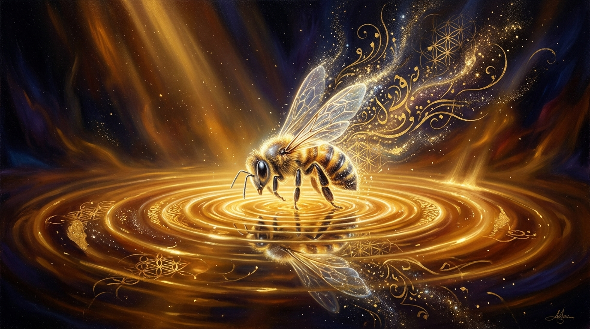
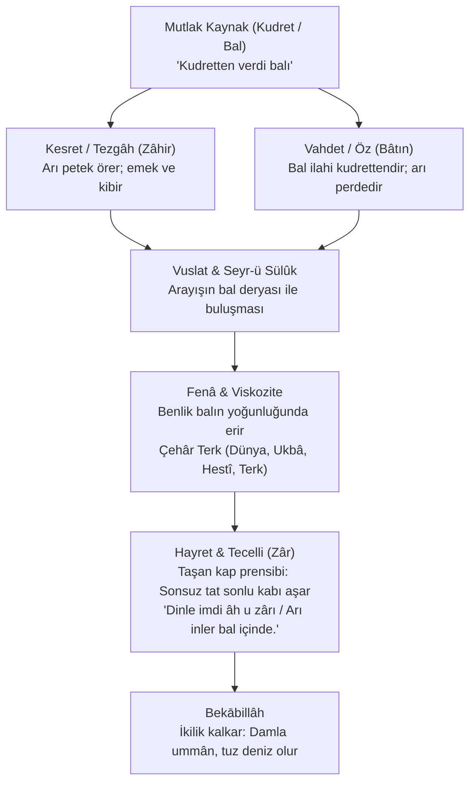
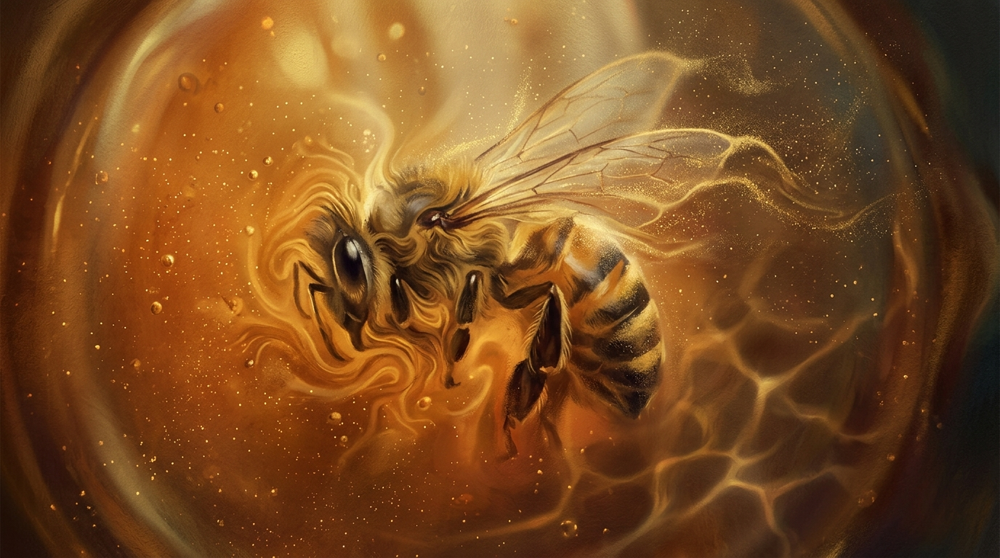
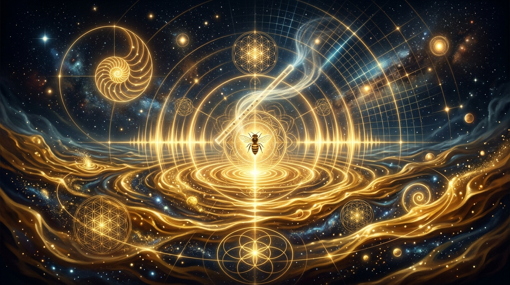

# 🍯 `ari-inler-bal-icinde`

[](https://github.com/bahattinyunus/ari-inler-bal-icinde/actions)
[](https://www.python.org/)
[](LICENSE)
[-success)](#)
[](#3-kanonik-literatür-taraması-ve-antoloji-30-eser)

> *"Kudretten verdi balı / Bahanesi oldu arı / Dinle imdi âh u zârı / Arı inler bal içinde."*  
> — **Anadolu İrfanı, Doğu Mistisizmi ve Vahdet-i Vücûd Geleneğinde:** Vuslat Paradoksu, Fenâ Mertebesi, Kesret-Vahdet Diyalektiği ve Hayret Makamının Ontolojik Mimarisi.

<p align="center">
  
</p>

---

## 📌 1. Giriş ve Hakikatin Çekirdeği

İnsanoğlunun ontolojik arayışındaki en yaygın yanılgı, inlemeyi (`zâr`), feryadı ve yakarışı yalnızca **ayrılık (`firkat`), sürgün ve mahrumiyet** hâline bağlamasıdır. Bu klasik arayış denkleminde mesafe acı üretir, kavuşma (`vuslat`) ise sessizlik ve sükûn vaat eder.

Ancak Alevi-Bektaşi deyişlerinden Melâmî neşvesine, Muhyiddin İbnü'l-Arabî'nin metafiziğinden Ferîdüddîn Attâr ve Mevlânâ'nın sembolizmine; oradan Meister Eckhart, Spinoza, Upanishadlar ve Ramakrishna'ya kadar uzanan Doğu ve Batı irfan kanonunda bu termodinamik tersyüz edilir:

> **Temel Paradoks:** Varlık, en çok arzuladığı mutlak kemâlata ulaştığı, onun içine gömüldüğü ve bizzat o kaynağın (`bal`) özüyle sarıldığı vuslatın tam merkezinde inler.

Bu kütüphane ve ontoloji motoru; **"Arı inler bal içinde"** mısrasının işaret ettiği şu üç kurucu hakikati edebi, tasavvufi ve matematiksel bir mimariyle modeller:

1. **İllüzyonun Yıkılışı (Kudret vs. Bahane):** Eylemin, eserin ve varlığın hakiki failinin idrak edilmesiyle sahte egonun (`ene`) bir yanılsamadan ibaret olduğunun kavranması (*Tevhid-i Ef'âl*).
2. **Fenâ ve Viskozite (Eriyen Kimlik):** Sonlu ve kırılgan bir formun, mutlak ve sonsuz bir derya içinde kendi sınırlarını yitirmesi; var olmak için biçimsel olarak yok olma zorunluluğu (*Fenâfillâh / Samadhi*).
3. **Hayret Makamı (Taşan Kap Prensibi):** Dışarıdan bakan bir gözün "ıstırap ve azap" zannettiği sesin; idraki, aklı ve kapasiteyi aşan mutlak bir lezzet karşısında verilen sarhoşluk, zikir ve vecd yanıtı olması (*Tahayyür*).

<p align="center">
  
  <br/>
  <em>«Kudretten verdi balı, bahanesi oldu arı...» — Pir Sultan Abdal / Tevhid-i Ef'âl Tecellisi</em>
</p>

---

## 🏛️ 2. Ontolojik Durum Mimarisi



<p align="center">
  
  <br/>
  <em>Balın viskozitesinde çözülen biçimsel benlik ve fenâfillâh teslimiyeti</em>
</p>

---

## 📚 3. Kanonik Literatür Taraması ve Antoloji (30 Eser)

Külliyat, Anadolu'nun 7 Ulu Ozanı'ndan klasik tasavvuf kanonuna ve evrensel non-dualist felsefeye uzanan **30 seçkin eser ve şerh** içerir:

### A. Anadolu İrfanı & 7 Ulu Ozan Geleneği
1. **Pir Sultan Abdal (Tevhid Nefesi):** *"Kudretten verdi balı / Bahanesi oldu arı / Şimdi dinle âh u zârı / Arı inler bal içinde... Balıklar deryaya hasret, çarka döner göl içinde, susuzluktan bağrı yanar..."*
2. **Yunus Emre (Divân):** *"Beni bende demen ben de değilem / Bir ben vardır bende benden içerü."*
3. **Yunus Emre (Risâletü'n-Nushiyye):** *"Balık derya içinde deryayı bilmez / Denizdeki katre deryadan ayrı mı ola?"*
4. **Şah İsmâil Hatâyî (Nefesler):** *"Derya-yı vahdete dalan dervişler / Katreyi ummâna katan erenler / Varlık libasını soyan erenler / Arı olup bal içinde inleyenlerdir."*
5. **Kul Himmet (Deyişler):** *"Arı inler petek sızlar bal ağlar / Erer mi bu akıl sırra bu gece?"*
6. **Kaygusuz Abdal (Gülistan):** *"Gevher-i lâ-mekândan geldik bu mülke / Arı olduk bal eyledik kovan içinde / Bir zerre iken güneşe erdik / Bir katre iken ummân olduk."*
7. **Vîrânî Baba (Risâle-i Vîrânî):** *"Cümle eşyada Hakk'ın sırrı nihan / Arı ile balı eyleyen ayan / Kudret kandilinde yanan bir nurdur..."*
8. **Derviş Yemînî (Fazîlet-nâme):** *"Vahdet deryasında kaynayan ol nur / Bala karışan arının canı durur."*
9. **Niyâzî-i Mısrî (Divân-ı İlahiyât):** *"Katre mevc urdu vü ummân oldu ol pinhân imiş / Zât-ı Hakk'ta fâni olan, bâkî olur mülk-i cânda."*
10. **Seyyid Nesîmî (Divân):** *"Mende sığar iki cihan, men bu cihana sığmazam / Gevher-i lâ-mekân menem, kevn ü mekâna sığmazam."*
11. **Fuzûlî (Gazeliyât):** *"Aşk derdiyle hoşem el çek ilâcımdan tabîb / Kılma dermân kim helâkim zehr-i dermânındadır."*
12. **Azîz Mahmûd Hüdâyî (Divân):** *"Kudret eliyle yoğrulmuş hamurumuz / Aşk deryasında çalkalanır nurumuz / Fenâfillâh içinde kayboldu gururumuz."*
13. **Hünkâr Hacı Bektaş-ı Veli (Makâlât):** *"Çeşme akıp denize vardığında artık ona çeşme denilmez, deniz denir."*

### B. Mevlevî ve Klasik Fars İrfanı
14. **Mevlânâ Celâleddîn-i Rûmî (Mesnevî 1-3):** *"Bişnev in ney çün şikâyet mî-kuned..."* Neyin iniltisi keder değil, nefesin yangınıdır.
15. **Mevlânâ Celâleddîn-i Rûmî (Dîvân-ı Kebîr):** *"Sinekle arı şeker deryasına daldığında kanat çırpmayı unutur... O artık baştan başa şeker kesilmiştir."*
16. **Şeyh Galip (Hüsn ü Aşk):** *"Mürg-i dil oldu şem'e hemzâd / Yandıkça yanar o şu'le-i cân / Nâr oldu hemân hemîşe handân."*
17. **Ferîdüddîn Attâr (Mantıku't-Tayr - Simurg):** Otuz kuşun Simurg aynasında eriyişi; fenâ-yı tâmm.
18. **Ferîdüddîn Attâr (Pervâne ve Mum Alegorisi):** Alevin içine atlayıp kül olan ve hakikati yalnızca bizzat yanarak bilen pervâne.
19. **Bâyezîd-i Bistâmî (Şatahât):** *"Otuz yıl Hakk'ı aradım; vardığımda gördüm ki arayan da O imiş, aranan da O imiş! Sahilsiz bir deryaya daldım."*
20. **Hallâc-ı Mansûr (Kitâbü't-Tavâsîn):** *"Ene'l-Hakk!"* Ateşte eriyen demirin 'Ben ateşim' diye haykırması.
21. **Sa'dî-i Şîrâzî (Bûstân):** Koca okyanusu görünce küçülüp utanan ve sedefte paha biçilmez bir inciye dönüşen yağmur damlası.
22. **Hâfız-ı Şîrâzî (Divân):** *"Aşk deryasının kenarı yoktur ey gönül; kurtulmak isteyen o denize girmesin!"*

### C. Vahdet-i Vücûd Metafiziği ve Vahiy
23. **Muhyiddin İbnü'l-Arabî (Fusûsu'l-Hikem & Fütûhât):** *Tahayyür (Kutsal Hayret)*. Aklın sonsuz tecelli deryasında hayrete düşmesi.
24. **Kur'an-ı Kerim (Enfâl 17):** *"Attığın zaman sen atmadın, lâkin Allah attı..."*
25. **Kur'an-ı Kerim (Nahl 68-69):** *"Rabbin bal arısına vahyetti..."* İlahi vahiy ve teslimiyetle üretilen şifa.

### D. Evrensel Non-Dualizm ve Batı Felsefesi
26. **Meister Eckhart (Almanca Vaazlar):** *"Tanrı'yı gördüğüm göz ile Tanrı'nın beni gördüğü göz aynı gözdür... Şarap fıçısına düşen damla şarap olur."*
27. **Baruch Spinoza (Ethica):** *"Deus sive Natura (Tanrı ya da Doğa)".* Tek ve sonsuz Töz (Substantia) ve entelektüel aşk (*amor intellectualis Dei*).
28. **Chandogya Upanishad (Advaita Vedanta):** *"Tat Tvam Asi (Sen O'sun!)"* Suya karışıp her zerrede bir olan tuz parçası.
29. **Sri Ramakrishna Paramahamsa (Kathamrita):** *"Tuz Bebek (Salt Doll)".* Denizin derinliğini ölçmek için suya giren ve eriyip denizin ta kendisi olan tuz bebek.
30. **Laozi (Tao Te Ching):** *"Wu Wei (Eylemsizlik) ve Su Erdemi".* Varlıkla yarışmayan, alçağa akan ve Tao'nun akışında eriyen bilinç.

---

## 🕊️ 4. Sembolik Motif Eşleştirme Matrisi

| Motif | Sembolizm | Temsilciler | Ontolojik Karşılık |
| :--- | :--- | :--- | :--- |
| **`ari-ve-bal`** | Arı vuslatın sarhoşluğuyla balın içinde inler. | Pir Sultan Abdal, Mevlânâ, Kul Himmet, Kaygusuz Abdal | Tat ve lezzet deryasında aklın iflası ve vecd. |
| **`damla-ve-umman`** | Katre okyanusa kavuşunca okyanus olur. | Niyâzî-i Mısrî, Yunus Emre, Şah Hatayi, Hacı Bektaş, Sa'di | Bireysel sınırların evrensel birlikte çözülmesi. |
| **`tuz-ve-deniz`** | Tuz suya girince erir, ölçen de ölçülen de kalmaz. | Chandogya Upanishad, Sri Ramakrishna | Non-dualizm (İkiliksizlik) ve Samadhi. |
| **`pervane-ve-ates`** | Kelebek kendini ateşe atar, alev gülümsemeye döner. | Ferîdüddîn Attâr, Şeyh Galip, Hallâc-ı Mansûr | Bizzat yanarak ve yok olarak hakikate erme. |
| **`ney-ve-nefes`** | Neyin iniltisi şikâyet değil, üfleyenin nefesidir. | Mevlânâ Celâleddîn-i Rûmî | Dar bedenden geçen ilahi kudretin rezonansı. |
| **`ayna-ve-suret`** | Bakan ile bakılan tek bir aynada özdeşleşir. | Meister Eckhart, Attâr (Simurg), Nesîmî | 'O'nu gören gözün O'nun gözü olması. |

<p align="center">
  
  <br/>
  <em>«Katre mevc urdu vü ummân oldu...» — Damlanın denizde, tuz bebeğin deryada erimesi</em>
</p>

---

## 📊 5. Suret (Zâhir / Avam) ile Hakikat (Bâtın / Havas) Matrisi

| Parametre | Zâhirî Bakış (Suret / Avam) | Bâtınî Bakış (Hakikat / Havas) | Kanonik Temel |
| :--- | :--- | :--- | :--- |
| **Fail Kimdir?** | Balı arı yapar; emek ve mülkiyet arınındır. | Bal ilahi kudrettendir; arı yalnızca tecelli perdesidir. | Enfâl 17 / Pir Sultan / Spinoza |
| **İnlemenin Sebebi** | Arı kapana kısıldı, kanatları yapıştı, acı çekiyor. | Sonsuz vuslatın lezzetinden sarhoş oldu, mesttir. | Fuzûlî / Rûmî / San Juan de la Cruz |
| **Varlık İlişkisi** | Arı ayrı, bal ayrı birer nesnedir (Dualizm / Kesret). | Arı balda erimiş, ikilik kalkmıştır (Vahdet / Advaita). | Niyâzî-i Mısrî / Upanishadlar |
| **Sesin Anlamı** | Şikâyet, sızlanma, çaresizlik. | Vecd, zikir, hayret ve sonlu kabın taşmasından doğan sır nidası. | Mesnevî / İbnü'l-Arabî / Eckhart |
| **Bitiş Noktası** | Yok oluş bir hezimet ve sondur. | Fenâ, ebedi dirilişin (Bekābillâh / Samadhi) yegâne eşiğidir. | Hallâc / Ramakrishna (Tuz Bebek) |

---

## 🧮 6. Matematiksel ve Metafizik Modelleme

### A. Benlik Çözünmesi ($E(t)$)
Sâlikin benlik oranı kesrette $1.0$, mutlak fenâda $0.0$'dır:
$$E(t) = \max\left(0, e^{-\lambda t} - 0.12 \cdot N_{terk}\right)$$
Burada $\lambda$ sâlikin teslimiyet süratini, $N_{terk} \in \{0, 1, 2, 3, 4\}$ ise aşılan terk basamaklarını (*Dünya, Ukbâ, Hestî, Terk*) ifade eder.

### B. Taşan Kap Prensibi (Hayret Katsayısı $H(t)$)
Sâlikin sonlu idrak kabı $C_{kap}(t) = E(t) + 0.10$ hacmindedir. Bal deryasının tecellisi $\Omega_{kudret}$ sınırsızca döküldüğünde taşma gerçekleşir:
$$H(t) = 1.5 \cdot \ln\left(1 + \frac{\Omega_{kudret} \cdot (1 - e^{-0.35 t})}{C_{kap}(t)}\right)$$

### C. Akustik Zâr Modülasyonu ($f_{zar}$)
Arının vızıltısı, benlik eridikçe kesretin sitemkar frekansından ($440\text{ Hz}$), Ney ve evrensel derya tonuna ($136.1\text{ Hz}$) ve altın oran harmoniklerine ($\phi \approx 1.618$) evrilir:
$$f_{zar}(t) = 440 \cdot E(t) + 136.1 \cdot (1 - E(t)) + \delta_{hayret}$$

<p align="center">
  
  <br/>
  <em>Hayret makamında taşan kap ve ney rezonansıyla yankılanan zâr sedası</em>
</p>

---

## 🚀 7. Kurulum ve Hızlı Başlangıç

Bu kütüphane **saf Python 3 standard library** ile yazılmıştır; harici bir paket kurmadan çalışır!

```bash
# Depoyu klonlayın
git clone https://github.com/bahattinyunus/ari-inler-bal-icinde.git
cd ari-inler-bal-icinde

# İsteğe bağlı yerel kurulum
pip install -e .
```

---

## 💻 8. Komut Satırı Arayüzü (CLI)

```bash
# 1. Seyr-ü Sülûk animasyonunu terminalde çalıştır
python -m ari_inler_bal_icinde simule --salik "Yunus" --viskozite 1.8

# Hızlı (beklemesiz) simülasyon
python -m ari_inler_bal_icinde simule --hizli

# 2. Rastgele günün hikmetini ve tefekkür alıntısını getir
python -m ari_inler_bal_icinde kesfet

# 3. İki arifi / geleneği yan yana karşılaştır (Örn: Pir Sultan vs Ramakrishna)
python -m ari_inler_bal_icinde karsilastir --id1 pir-sultan-abdal --id2 ramakrishna-tuz-bebek

# 4. Külliyat antoloji ve istatistik raporunu göster
python -m ari_inler_bal_icinde antoloji

# 5. Kanonik kütüphanede gelenek ve motife göre arama yap
python -m ari_inler_bal_icinde divan -g "Anadolu İrfanı"
python -m ari_inler_bal_icinde divan -m "tuz-ve-deniz"
python -m ari_inler_bal_icinde divan -a "Spinoza"

# 6. Zâhir vs Bâtın ontolojik matrisini görüntüle
python -m ari_inler_bal_icinde matris

# 7. Belli bir benlik oranında Zâr frekansını ve harmoniklerini hesapla
python -m ari_inler_bal_icinde zar --benlik 0.15

# 8. İnteraktif Web UI ve REST API sunucusunu başlat
python -m ari_inler_bal_icinde web --port 8080 --tarayici

# 9. Ontolojik manifestoyu oku
python -m ari_inler_bal_icinde manifesto
```

---

## 🌐 9. İnteraktif Web Arayüzü & Web Audio Sentezleyici

Proje, görsel ve işitsel tecrübe sunan yerleşik bir web uygulaması içerir:
- **Tefekkür Modülü (Günün Hikmeti):** Her açılışta veya butona tıklandığında 30 seçkin eserden rastgele bir vuslat tefekkürü sunar.
- **Gelenek ve Motif Filtreleri:** Anadolu İrfanı, Mevlevî, Klasik Fars, Vahdet-i Vücûd ve Evrensel Felsefe arasında anında filtreleme sağlar.
- **HTML5 Canvas Sıvı Simülasyonu:** Arının bal deryasına dalışını, kanatlarının viskoziteye kapılışını ve binlerce altın ışık parçacığına dönüşerek deryada eriyişini canlı simüle eder.
- **Web Audio API Zâr Sentezleyicisi:** Gerçek zamanlı mikrotonal ses sentezleyici; $440\text{ Hz}$ telaşlı arı vızıltısından $136.1\text{ Hz}$ Ney tonuna ve altın oran harmoniklerine kesintisiz modülasyon sağlar.
- **Canlı Telemetri & Zaman Çizelgesi:** Benlik, Viskozite Direnci, Hayret Seviyesi ve Makam basamaklarını anlık gösterir.

Çalıştırmak için:
```bash
python -m ari_inler_bal_icinde web --tarayici
```
*(Veya doğrudan `web/index.html` dosyasını tarayıcınızda çift tıklayarak açabilirsiniz; sıfır bağımlılıkla yerel olarak da çalışır!)*

---

## 🐍 10. Python API Kullanımı

```python
from ari_inler_bal_icinde import ParadoksSimulasyonu, simule_et, KanonikKutuphane

# Tek satırda tam simülasyon çalıştırma
sonuc = simule_et(salik_adi="Derviş Yunus", viskozite=1.618, cozulme_hizi=0.28)
print(sonuc.ozet)
print("Hüküm:", sonuc.zar_tecellisi.hukum)

# Külliyat Sorgulama ve Karşılaştırma
kutuphane = KanonikKutuphane()

# Motife göre arama
for m in kutuphane.motife_gore_ara("tuz-ve-deniz"):
    print(f"[{m.muellif}]: {m.orijinal_metin}\n")

# İki arifi yan yana karşılaştırma
analiz = kutuphane.karsilastir("pir-sultan-abdal", "meister-eckhart-goz-ve-damla")
print("Sentez:", analiz["sentez"])

# Rastgele tefekkür
gunun_hikmeti = kutuphane.rastgele_getir()
print(f"Hikmet: {gunun_hikmeti.muellif} -> {gunun_hikmeti.ana_fikir}")
```

---

## 🧪 11. Testler

Tüm birim testleri (48 test) Python standard `unittest` modülüyle çalıştırılır:

```bash
python -m unittest discover -s tests -v
```

---

## 📂 12. Proje Yapısı

```
ari-inler-bal-icinde/
├── .github/workflows/ci.yml       # GitHub Actions çoklu platform CI
├── .gitignore                     # Git yoksayma kuralları
├── LICENSE                        # MIT Lisansı
├── README.md                      # Kapsamlı manifesto, antoloji ve 5 görsel
├── pyproject.toml                 # Paket ve metaveri yapılandırması
├── setup.py                       # Setuptools kurulum scripti
├── requirements.txt               # Harici bağımlılık gerekmez (stdlib)
├── requirements-dev.txt           # Test ve geliştirici bağımlılıkları
├── assets/images/                 # 5 Özgün İrfani ve Tasavvufi Görsel
│   ├── 01_hero_ari_bal_vuslat.png # Vuslat ve Fenâ Hero Görseli
│   ├── 02_kudret_ve_bahane.png    # Tevhid-i Ef'âl ve Bal Akışı
│   ├── 03_fena_ve_viskozite.png   # Viskozite ve Çözülen Benlik
│   ├── 04_hayret_ve_zar.png       # Akustik Rezonans ve Ney Sedası
│   └── 05_katre_ve_umman.png      # Katre, Ummân ve Tuz Bebek
├── ari_inler_bal_icinde/          # Ana Python paketi
│   ├── __init__.py                # Dışa aktarılan sınıflar ve versiyon
│   ├── __main__.py                # `python -m ari_inler_bal_icinde` girişi
│   ├── models.py                  # Makam, Nefs, SalikDurumu, ZarTecellisi
│   ├── physics.py                 # Viskozite, çözülme matematiği ve ses fiziği
│   ├── ontology.py                # VarlikDeryasi, Ari, KudretVeBahaneMotoru
│   ├── corpus.py                  # 30 Eserlik külliyat, karşılaştırma motoru ve antoloji
│   ├── engine.py                  # Paradoks simülasyon orkestratörü
│   ├── cli.py                     # Zengin CLI (simule, matris, divan, kesfet, karsilastir, antoloji, zar)
│   ├── web_server.py              # Yerleşik HTTP sunucusu ve genişletilmiş REST API
│   └── data/
│       └── canonical_texts.json   # 30 Kanonik metin, çeviri, şerh ve motif veritabanı
├── web/                           # İnteraktif Web Arayüzü (Zero-dependency)
│   ├── index.html                 # HTML5 Dashboard ve Tefekkür Modülü
│   ├── style.css                  # Kehribar ve obsidyen teması, filtre hapları
│   └── app.js                     # Canvas parçacık fiziği, sentezleyici ve filtreleme
├── examples/                      # Çalıştırılabilir örnekler
│   ├── basic_simulation.py        # Temel simülasyon
│   ├── corpus_search.py           # Külliyat, motif ve karşılaştırmalı sorgu
│   ├── audio_parameters.py        # Akustik frekans dönüşümü
│   └── custom_salik.py            # Özel sâlik akış testi
└── tests/                         # Kapsamlı test paketi (48 test)
    ├── test_models.py
    ├── test_physics.py
    ├── test_ontology.py
    ├── test_corpus.py
    ├── test_engine.py
    ├── test_cli.py
    └── test_web_server.py
```

---

## 📜 13. Lisans ve Miras

Bu proje [MIT Lisansı](LICENSE) ile korunmaktadır.

Bu manifesto ve model; Yunus Emre'nin, Pir Sultan'ın, Niyâzî-i Mısrî'nin, Mevlânâ'nın, Hallâc-ı Mansûr'un, Spinoza'nın, Meister Eckhart'ın ve cümle ariflerin müşterek manevi mirasına hürmeten açık kaynak olarak insanlığın istifadesine sunulmuştur. Hakikate kanat çırpan, deryada erimeye talip olan herkese açıktır.